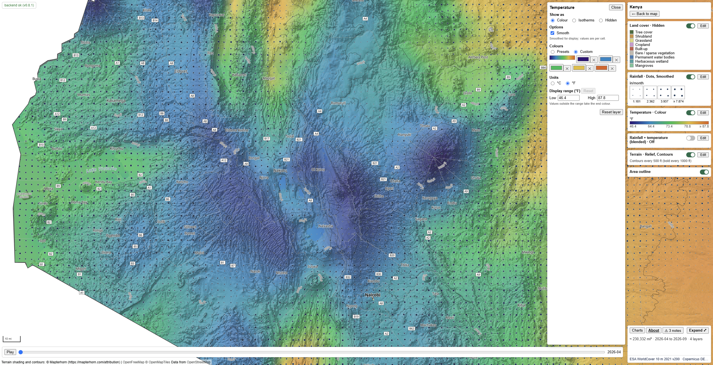
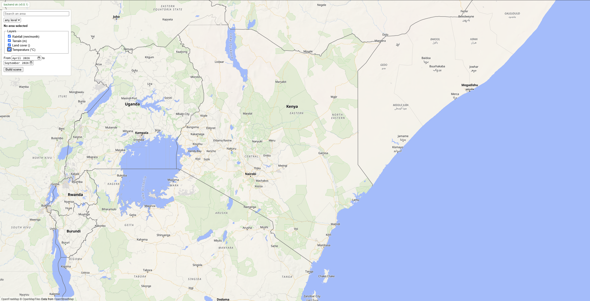
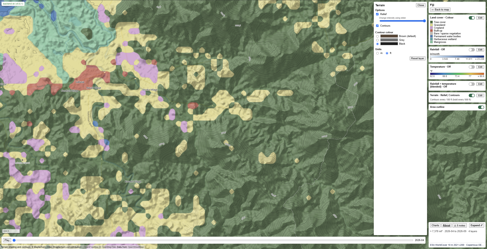
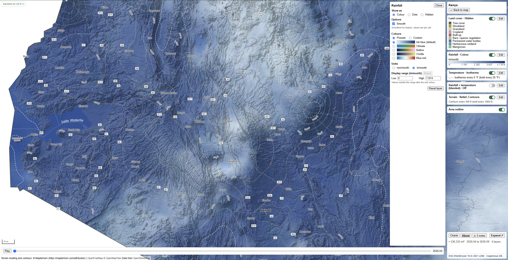

# Scenes of Earth



Scenes of Earth is an open-source web application for exploring and sharing climate and geographic data through special interactive maps known as **scenes**, that serve as highly configurable sandboxes for environmental datasets. Users can choose to select a country, state, county, major city, or draw their own region, then explore layers such as rainfall, temperature, terrain, and land cover (more to be added later) using editable layers and a time slider.

Each saved scene combines a region, selected datasets, and a date range. Shareable URLs identify the scene and encode its viewing settings, allowing others to open and explore the same view. The aim is to support scientific communication by making environmental data easier to explore and discuss, while also attempting to promote interest and outreach simply through the innate visual beauty that it offers.

A FastAPI and SQLite backend prepares reusable scene bundles containing metadata (scene.json), geographic boundaries (area.geojson), and chunked arrays in Zarr v3 format (data.zarr). The browser reads completed bundles directly. Each bundle has a content-based ID and remains unchanged after publication, allowing it to be cached and reused.

Planned features and hosting: [docs/ROADMAP.md](docs/ROADMAP.md).

**The devcontainer (Linux) is the supported environment.** The code also runs on Windows, but deep checkouts can hit the
260-character path limit.

## Setup

Open the folder in the devcontainer (Python 3.12, Node LTS, GitHub CLI, Claude Code). It runs
`pip install -e '.[import,dev]'` once. Without the devcontainer: `pip install -e '.[import,dev]'` in a Python >= 3.11 venv.

## Run

```
uvicorn main:app --reload --port 8000
```

Without `SOE_SYNTHETIC=1` and without the CHIRPS cube (see Cubes), the first start probes CHIRPS online (a few HEAD
requests, in the background) for the latest month, so it needs network access.

For the frontend (`npm run dev`, port 5173), set the Vite dev server to proxy `/api` and `/scenes` to
`http://localhost:8000`, so the browser uses the same relative URLs as in production and needs no CORS setup.

Frontend (`web/`): `npm install`, then `npm run dev` (port 5173), `npm run build` (typecheck plus bundle) and `npm test`
(Node's built-in runner, no framework). A built scene opens by id with `http://localhost:5173/?scene=<id>`, which is also
how to share it. The page draws terrain shading and contour lines from shared elevation tiles (the intervals
come from the elevation statistics in the bundle) and the rain series from the bundle's Zarr store, each toggleable, with a time slider and a blocky or smooth rain look.

API: `GET /api/health`, `GET /api/layers` (per layer: id, title, kind, units, coverage, time step with the first and last request period,
`request_step`, and the default set),
`GET /api/areas/search?q=&level=&limit=`, `GET /api/areas/{id}`, `POST /api/scenes`,
`GET /api/scenes/{id}`, and the static files under `/scenes/{id}/`. `POST /api/scenes` takes
`{"area": {"type": "boundary", "id": ...} | {"type": "polygon", "geometry": GeoJSON}, "start": "YYYY-MM",
"end": "YYYY-MM", "layers": ["chirps_monthly", "terrain"], "title": ...}` and returns 202 (queued or running),
200 (already built), 422 (refused, with a reason), 413, or 503 (queue full or data server unreachable; `Retry-After`).

With `SOE_SYNTHETIC=1`, five sample areas (Kenya, Fiji, Nairobi, Cusco, Burkina Faso) are
loaded from `soe/data/sample_areas.geojson`, so search works without the boundaries import. They are real
geoBoundaries gbOpen outlines simplified to about 0.01 degrees; each feature carries its own licence and source. They
reload on every synthetic start, unless real boundaries are imported.

## Share links

A scene link is `?scene=<id>` plus optional parameters. The app writes them as you change the scene, and
the parameters below describe what a link can carry.

- `t` is the time step, as a year (`2019`), month (`2019-03`) or day (`2019-03-05`).
- `pal` lists `layer:palette` pairs. The app names the palette of every layer that has an Edit menu, so
  the receiver sees the sender's colours. A palette is a built-in name, or `custom-` followed by two to
  five six-digit hex colours separated by hyphens (`custom-1a2b3c-88cc44`). For the terrain layer it is
  the contour colour (`brown`, `grey` or `black`).
- `range` lists `layer:low:high` display ranges for field layers. Values may lie outside the values in
  the area and are rounded to the precision of the data.
- `off` lists the layers or parts that start switched off, such as `terrain.contours`.
- `colour` names the layer that holds the map's colours, or `blend` for the combined rainfall and
  temperature layer. Every other visible layer then draws dots, isotherms or outlines instead. The
  app writes the effective owner, so the receiver sees the sender's choice even when this browser
  remembers a different pick.

Entries the scene cannot use are ignored and a note says so. Settings from a link apply to that visit
only, while the palettes you pick in the menu are also remembered in this browser.

## Import boundaries (once)

Download and unzip into a folder, then:

```
python -m soe.cli import-boundaries --cgaz <folder> --ucdb <GHS_UCDB file or zip> --meta <folder>
```

- geoBoundaries CGAZ (ADM0, ADM1, ADM2 GeoPackages): https://www.geoboundaries.org/globalDownloads.html
  (files are in https://github.com/wmgeolab/geoBoundaries/tree/main/releaseData/CGAZ; use the media.githubusercontent.com
  links, the raw links return Git LFS pointers).
- GHS-UCDB R2024A: https://human-settlement.emergency.copernicus.eu/ghs_ucdb_2024.php (only cities of 1,000,000 or
  more people are imported).
- geoBoundaries gbOpen level metadata (each country's own ADM1/ADM2 type names, shown in area search):
  https://www.geoboundaries.org/api/current/gbOpen/ALL/ADM1/ and
  https://www.geoboundaries.org/api/current/gbOpen/ALL/ADM2/ (save each response as
  gbOpen-ADM1.json and gbOpen-ADM2.json in one folder, then pass it as `--meta`).
  Each record names its own `boundaryLicense` (Public Domain, ODbL 1.0, CC BY variants and national
  open-data terms); only the type names are stored, so reuse follows the licence of the names shown
  (details under Data sources).

The import is large (several hundred MB of input, about a gigabyte in SQLite). CGAZ draws disputed borders to US State Department definitions.
Search shows each country's own name for its levels (County, Canton) where the metadata
names one, else the generic level; countries and cities always show the generic level.
The stored outlines keep every CGAZ vertex, so search never reads the geometry column and stays
fast; simplification happens only for display (see the bundle notes).

## Cubes (once, then monthly)

Builds read monthly Zarr cubes from local disk (`SOE_CUBES_DIR`). Reading the cubes makes no network calls. Rainfall reads each month from the CHIRPS cube when it holds that month, and over HTTP otherwise, so a checkout without the CHIRPS cube still builds:

| Cube | Folder | Used for |
|---|---|---|
| ERA5-Land 2 m temperature | `era5land_temperature.zarr` | Temperature (main source) |
| ERA5 2 m temperature | `era5_temperature.zarr` | Temperature cells where ERA5-Land has no land value |
| ERA5 total precipitation | `era5_precipitation.zarr` | Rainfall cells where CHIRPS has no value |
| CHIRPS monthly rain | `chirps_monthly.zarr` | Rainfall (main source), optional |

Rainfall and Temperature are listed only when their ERA5 cubes exist, so no layer lacks the data that fills its gaps. The fill
is automatic. ERA5-Land and CHIRPS values are never changed, except that a CHIRPS value above 6553.4 mm/month, which the
cube cannot store, counts as no value and ERA5 fills it. ERA5 is sampled at the centre of each native layer cell,
and a scene that is averaged over blocks of cells averages these samples the same way as the main source. Only an output
cell with no main-source value takes the ERA5 value (about 28 km, over land and sea). A filled bundle carries a `source`
array (1 main source, 2 fallback, 3 both, 0 outside the area or no value), lists ERA5 under `fallback_sources`, and states
the number of filled cells in its notices. Nothing is marked on the map.

The ERA5 cubes are filled from the Copernicus Climate Data Store (CDS), one request per year. They need a CDS account, the key in
`~/.cdsapirc` (https://cds.climate.copernicus.eu/how-to-api), and the licences accepted on the dataset pages
(https://cds.climate.copernicus.eu/datasets/reanalysis-era5-land-monthly-means and
https://cds.climate.copernicus.eu/datasets/reanalysis-era5-single-levels-monthly-means).

```
python -m soe.cli ingest-cube era5land_temperature --from 1981-01
python -m soe.cli ingest-cube era5_temperature --from 1981-01
python -m soe.cli ingest-cube era5_precipitation --from 1981-01
```

The CHIRPS cube needs no account. Its first run downloads about 16 GB (1981-01 onward, about 1.5 hours) and stores about
3 to 5 GB. CHIRPS v3.0 covers 60°S to 60°N. Negative fill and values above 6553.4 mm/month are stored as no value. Implausible
values below that limit are kept, for example 1998-08 near the Falklands, where a few hundred cells exceed 2000 mm.

```
python -m soe.cli ingest-cube chirps_monthly --from 1981-01
```

With the CHIRPS cube, Rainfall's newest month is the earlier of the cube's newest month and the ERA5 fallback's, and
builds make no latest-month probe (`SOE_LATEST` and the startup probe do not apply). A build whose months the cube
holds all makes no CHIRPS request at all; a cube that starts later than the request still reads its older months
over HTTP. A rain scene read from the cube gets a different id from one read over HTTP, and scenes built before the
cube existed are built again once. Run it monthly, around the 20th, because CHIRPS publishes
final months about mid-month.

The three ERA5 cubes start at CHIRPS' first month (1981-01), so both layers offer 1981-01 onward. Each layer offers only the months
that all of its cubes hold. The first run of a cube starts at `--from`; later runs continue after the last stored month and fetch
again every month still marked preliminary (final data replaces it about two months later, and the scene then gets a new
id). The newest month may be skipped when the CDS has not published it yet. Restart the server after the first ingests, so
the layers are listed. Builds that need a cube get 503 while an ingest is publishing (seconds per month); if an ingest fails
in that step, the layer stays unavailable until the next run, which refetches the affected months. Run the three ERA5 cubes monthly,
around the 8th. A `--from` before a cube's first stored month adds the earlier months, newest year first, so a cube
that started later can be extended backwards without a rebuild. An ERA5 month with a missing cell, or values that its cube cannot hold, is refused and nothing is stored.

## Terrain tile index

`soe/data/glo30_tiles.bin` and `soe/data/glo90_tiles.bin` list which GLO-30 and GLO-90 tiles exist (ocean tiles do
not), so planning stays offline. GLO-30 lacks 25 tiles in the Caucasus (N38-41, E043-050); GLO-90 fills them.
Rebuild them only if a bucket's tile list changes:

```
python -m soe.cli terrain-index
```

## Land cover tile index

`soe/data/worldcover_tiles.bin` lists the ESA WorldCover 3 degree tiles that exist (it has no ocean tiles), so planning
stays offline and a request over open sea is refused with 422 before any read. Rebuild it only if the product's grid
changes:

```
python -m soe.cli worldcover-index
```

## Geology map

The Geology layer (`geology`, not a default layer) reads one COG, `lithology.tif`, in the cubes folder, and is listed only
when that file exists. Build it once with the command below. When the GLiM v1.0 geodatabase is unpacked at
`data/cubes/.downloads/glim/LiMW_GIS 2015.gdb`, the COG is rasterised from it (level 1 and 2 codes, 88 classes, onto the
1/480 degree grid from 60S to 60N; water bodies and no data become 0). Without it, the command downloads the 232 MB
OpenLandMap lithology map from Zenodo and crops it to 60S-60N, turns water and the undefined class into no data (0) and
repairs its edge columns. Either way the result is a tiled ZSTD COG with most-common-class overviews (a few hundred MB), and a
`LITHOLOGY_SOURCE` tag in it names the source, so the layer's classes, source and licence follow the COG.

```
python -m soe.cli ingest-lithology
```

## Geology age map

The Geology age layer (`geology_age`, not a default layer) reads one COG, `geology_age.tif`, in the cubes folder, and is
listed only when that file exists. Build it once with the command below. It fetches five small members (about 27 MB) of the
577 MB archive of Geological Survey of Canada Open File 5529 (Chorlton 2007) by HTTP range reads into
`data/cubes/.downloads/gsc-of5529/`, gives each map unit the class of its age range, and rasterises the units onto the
1/120 degree grid from 60S to 60N (0 = no data). The result is a few-MB tiled ZSTD COG with most-common-class overviews and
a `LITHOLOGY_SOURCE` tag set to `gsc-of5529`. `--archive of_5529.zip` takes a local copy instead of fetching.

```
python -m soe.cli ingest-geology-age
```

A unit's class is the smallest ICS unit that holds its whole age range: a period, else its era marked undivided, else
Phanerozoic, Proterozoic or Precambrian undivided, else "Precambrian to Phanerozoic" (23 classes, in `soe/geology_age.py`).
Ranges come from the age names of the source and never from Ma, because GSC uses the 1989 time scale. An age name without a
class fails the ingest and lists every such name. The cross-eon class uses grey instead of white so it stays visible
on the map.

## Area contract notes

- `area.bbox` is `[W, S, E, N]` with W < E always. A shape across the antimeridian is unwrapped into one frame, so E may be
  above 180 (up to 360) and `lon` arrays rise past 180, as MapLibre's `LngLatBounds` does. `area.geojson` is in the same frame.
- `scene.json` is version 0.7 and the generator is 0.9.1. The top-level `period` (`start`, `end` exclusive, `step`; ISO dates) is the requested range,
  or `null` for a scene without series. Each layer has its own `grid` (crs, bbox, res, nx, ny; `aggregation` for series), `mask`,
  `coverage`, `time` (`step` as an ISO 8601 duration, `end` = the day after the last step's period, `method` = how a step summarises
  its period (`sum`, `mean`, `point`, `max`), `count`, explicit `values`, or `null` for static layers) and
  `arrays` keyed by role (`value`, ...) with `dtype`, `scale_factor`, `add_offset` and `fill`. A static layer drawn from tiles has
  `arrays` `{}` and instead a `tiles` block (`url`, `encoding`, `tile_size`, `maxzoom`, `source`) plus `stats` and, for terrain, `distribution`.
  Time-varying continuous layers also carry `area_series`, and `credits` carries `terms_passthrough` with the reuse terms.
  Each layer's `style` has `kind` (`field` for a continuous grid, `categorical` with `style.classes` `[{value, label, color}]`, `terrain`), `encodings` (the display types it offers, best
  first; a viewer skips names it does not know) and optional `parts` (extra display types drawn alongside, e.g. terrain's
  `contours`). A series layer also has `palette` (default colours) and `style.stops`: 2-9 increasing values fitted to the
  area over all steps (half an even stretch, half quantiles, rounded to two significant digits of the span so a 288-300
  field keeps whole degrees; rain starts at 0; a constant field has equal ends), evenly spaced along the palette.
  Stored value = (real value - add_offset) / scale_factor; every array also carries `scale_factor`, `add_offset` and, when
  set, the Zarr `fill_value`. The uint8 `mask` stores 0 for outside, 1 for area cells and 2 for
  a one-cell ring of real source values along outer edges and holes. The ring uses four edge
  neighbours and stops at source coverage; it never invents values. Values on 1 or 2 survive
  storage while 0 and genuine source no-data hold fill. The viewer displays only mask 1;
  isotherms use the hidden ring to reach the outline and are clipped by the area geometry.
  Statistics, style stops, notices, provenance codes and `cells_inside` count only mask 1.
  Ring-only fallback values still credit their source but add no area fallback count or notice.
- Layer `units` stay as the source values (`mm/month`, `°C`, `m`). A monthly area mean is the mean for that month
  and temporal accumulation stays separate from spatial averaging, so monthly rainfall is not an area total.
  Means describe the build analysis grid including any `aggregation` and cannot recover variation within a coarse cell.
  `grid.res` is the unrounded grid spacing in degrees with the bbox and dimensions, not a product name or live tile resolution.
- Time-varying continuous layers carry inline `area_series` with `statistic` `mean`, `weights` `cell_area_inside_outline`
  and per-step `values`, `valid_fraction` and `fallback_fraction` when a fallback is configured. Each cell contributes
  with cosine latitude correction times its overlap with the outline, so boundary cells count only partly. Shares divide
  by outlined area rather than by cell count, so `valid_fraction` is valid area over outlined area and `fallback_fraction`
  is fallback area over outlined area. This is a grid approximation rather than an ellipsoidal survey. Each array has
  `time.count` entries aligned with `time.values`. Means accumulate in float64 from finite decoded source values before
  packing and keep full precision, so values that differ only below packing precision stay different after serialization.
  A 480-step rainfall plus temperature `scene.json` is about 86 kB. A later daily-scale table would live beside the bundle
  with bundle-relative paths and no new API or database. Bundles are published atomically with `scene.json` last.
- Terrain carries `distribution` with `statistic` `quantiles`, the same weights, `percent` 1, 101 nondecreasing `values`,
  exact `min`/`max`/`mean`, `valid_fraction` and `reference_values`. Quantiles follow the inverse empirical curve with exact
  endpoints and no interpolation, so the median is `values[50]` and `stats` mirrors the distribution with `p2` as `values[2]`
  and `p98` as `values[98]`. Elevations keep source units and full precision. Absent tiles and nodata are excluded, while
  sea encoded inside published coastal tiles is still included because no water mask exists yet. Genuine zero-height land
  is preserved, so coastal means are not land-only. `reference_values` may hold sea level 0 only when valid heights span
  zero or the outline overlaps an ocean square missing from both GLO indexes, which is a coarse test, and markers never
  enter the samples. `categorical_shares` and any `path` in `area_series` or `distribution` are reserved for later
  and rejected in v1, as are other statistics or weights.
- `credits` carries `terms_passthrough` with the reuse terms that bind later users, alongside `lines`, `disclaimers` and
  `endorsement`. Positive `fallback_fraction` shares need credited `fallback_sources`, while all-zero shares may appear without
  them. Ring-only fallback still needs attribution though its share is zero.
- Rain is stored as uint16 at 0.1 mm (fill 65535, ERA5 values above 6553.4 mm are clipped and CHIRPS values above it become no data). Series are chunked one step per
  chunk and sharded 12 steps per shard; static arrays are one chunk each. The root `zarr.json` has consolidated metadata.
- Budgets: the raw size of all layers' arrays together is capped at 50 MB, and the source cells x steps read for all
  time-varying layers together at 100M. Terrain is planned first; each time-varying layer then gets its own aggregation
  factor (the finest output coarsened first, never beyond 0.4 degrees).
- Temperature is stored as int16 at 0.1 °C (fill -32768), `time.method` `mean`, on its own 0.1 degree grid whose cell
  centres lie on 0.1 degree multiples (half a cell off the rain grid). It is listed only when the cube below exists.
- Rain and terrain are anchored to the 60S-60N grid of 0.05 degree cells that starts at 180W. `area.geojson` is the area
  clipped to the coverage of all selected layers, simplified for display to a quarter of the scene's finest grid cell
  (never below 0.0005 degrees), so one layer's mask can reach slightly beyond the outline. Masks, statistics, style
  stops and scene ids all use the full stored outline, which is why the bundle format stays at 0.7: old bundles keep
  their exact outline and every reader treats `area.geojson` as display-only.
- The terrain layer holds no elevation array. The viewer draws shading and contours from the elevation tiles named by
  `layers[].tiles` (Terrarium encoding, 512 px, Mapterhorn by default), and the build keeps `stats` (`min`, `max`, `mean`,
  `p2`, `p98`, `slope_p50_deg`, `slope_p90_deg`, `cell_m`) with `distribution`, both taken on mask 1, which choose the
  contour intervals. Absent tiles and nodata are excluded, while in-tile sea is still included until a water mask exists.
  Genuine zero-height land is preserved. The tile URL is part of the scene id, so pointing `SOE_TERRAIN_TILES` at another
  copy renames the scenes. With `SOE_SYNTHETIC=1` the statistics are fake while the tiles are still the real hosted ones.
- Land cover (`esa_worldcover`, not a default layer) is a static `categorical` layer with a uint8
  `value` array (0 = no data or outside the stored area and ring) on cells of 0.05/k degrees
  (the same budget as terrain), holding the most common ESA WorldCover class
  in each cell. It reads the tile's COG overview with at least 16 source pixels per cell (the 0.5 degree spike agreed with
  full resolution on 96.7-97.8 % of cells). `style.classes` holds the official colours; `style.palette: "painted"` names the
  softer set the viewer holds by default, and its "ESA colours" option switches to the official ones. Land cover is refused
  above 400 source tiles.
- Geology (`geology`, not a default layer) is a static `categorical` layer built like land cover, with a uint8 `value`
  array (0 = no data, water or undefined) holding the most common rock class in each cell of the lithology map, read from
  the local COG: GLiM level 1 + 2 when the COG was built from it (88 classes), else the 14 OpenLandMap classes. Its
  `style.classes` carry an optional `group` (Sediments, Volcanic, Plutonic, Metamorphic, Ice/other) that the legend uses as
  collapsible headings, and GLiM classes also carry `parent` (the level 1 code) and `variant` (its position under the parent),
  from which the viewer shades the sub-classes of one family. The source, and so the scene id, follows the COG. The notice
  states the 1:3.75 million source scale and the seams where source maps meet (OpenLandMap also at 180 degrees and its
  missing islands). It shows rock type now, and rock age is planned inside the same layer.
- Geology age (`geology_age`, not a default layer) is a static `categorical` layer built exactly like Geology from its own
  COG: a uint8 `value` array (0 = no data) holding the most common age class in each cell of the world map GSC Open File 5529
  (23 classes, see "Geology age map"). `style.classes` carry the ICS chart colours and a `group` for the era (Cenozoic,
  Mesozoic, Paleozoic, Precambrian, Several eras), and the layer has no `style.palette`, so the viewer shows those colours.
  The notice states the 1:35 million scale, the tens of kilometres of boundary error, the share dated only to an era and the
  generalisation to ICS periods. Adding the COG changes no existing scene id.
- The statistics are read on cells of 0.05/k degrees (k up to 180, about 4.2 Mpx at most). Cells finer than 90 m are read
  from GLO-30 (with average resampling), others from GLO-90; tiles GLO-30 lacks come from GLO-90 as
  `layers[].fallback_sources`. Terrain is refused above 2500 existing source tiles.
- Terrain reads are cached in `SCENES_DIR/.cache/` (keyed by dataset, source versions, bbox, res and soe version), so
  rebuilding an area with other layers or dates does not read the tiles again. Deleting the folder is always safe, and it
  is the way to clear files that older versions left behind.
- Format 0.7 keeps the real-data ring and adds `area_series` with `distribution`. Generator 0.9.1 and the bundle format
  both enter the scene id, so new requests cannot reuse older bundles and old terrain caches are not reused. Build a new scene
  rather than replacing an immutable bundle in place. The viewer rejects older formats with a prompt to pick the area again.
- Contours use `maplibre-contour` (BSD-3-Clause) with a scene-seeded nested 10–2000 m ladder. New tiers fade in over
  0.75 zoom levels and are traced one zoom early. Geometry stops refining at z12; bold heights never change on zoom.
  Labels are bold-only until the Kenya/Fiji/flat-area trial establishes whether the sparse-label fallback is needed.
  The plugin's shared worker and 50-tile caches are reused for each distinct tile source for the life of the page,
  because version 0.1.1 has no manager-disposal API.

## Environment variables

| Name | Default | Meaning |
|---|---|---|
| `SOE_DB` | `./data/soe.db` | SQLite file |
| `SOE_SCENES_DIR` | `./data/scenes` | Where bundles are written and served from |
| `SOE_PUBLIC_BASE` | `/scenes` | Public URL prefix of bundles (set to the R2 URL in production) |
| `SOE_MAX_BUILDS` | `1` | Concurrent builds |
| `SOE_MAX_QUEUE` | `20` | Queued plus running jobs before new ones get 503 |
| `SOE_SYNTHETIC` | `0` | `1` uses fake offline data |
| `SOE_LATEST` | probed | Fix the latest CHIRPS month (`YYYY-MM`) and skip the probe; unused when the CHIRPS cube exists |
| `SOE_CUBES_DIR` | `./data/cubes` | Where the ERA5-Land, ERA5 and CHIRPS cubes are read from and written to |
| `SOE_TERRAIN_TILES` | `https://tiles.mapterhorn.com/{z}/{x}/{y}.webp` | Elevation tile URL template, absolute or relative to `bundle_url` |

## Tests

```
pytest
```

All tests run offline with synthetic data.

## Data sources, licences and attribution

Every bundle carries these in `scene.json` (`layers[].source`, `area.boundary`, `credits`) and in the Zarr root attributes.
The data providers do not endorse Scenes of Earth. Reuse of a bundle's data is subject to each source's licence.

- **Rain: CHIRPS v3** (Climate Hazards Center, UC Santa Barbara), CC BY 4.0. Funk, C. et al. (2026) The Climate Hazards
  Center Infrared Precipitation with Stations, Version 3. Scientific Data 13, 718, doi:10.1038/s41597-026-07096-4;
  dataset doi:10.15780/G2JQ0P. https://www.chc.ucsb.edu/data/chirps3
- **Temperature: ERA5-Land monthly averaged data from 1950 to present** (ECMWF, Copernicus Climate Change Service),
  CC BY 4.0. Required attribution: "contains modified Copernicus Climate Change Service information 2026
  (ERA5-Land)". Disclaimer: "Neither the European Commission nor ECMWF is responsible for any use that may be made of
  the Copernicus information or data it contains." Citation: Muñoz Sabater, J. (2019): ERA5-Land monthly averaged data
  from 1950 to present. Copernicus Climate Change Service (C3S) Climate Data Store (CDS), doi:10.24381/cds.68d2bb30;
  Muñoz-Sabater, J. et al. (2021) Earth Syst. Sci. Data 13, 4349-4383, doi:10.5194/essd-13-4349-2021. Converted from K to
  °C and cropped to 60S-60N; preliminary (ERA5-Land-T) months carry a notice. The same text is in `soe/sources/licences.py`.
- **Gap fill for temperature and rain: ERA5 monthly averaged data on single levels from 1940 to present** (ECMWF,
  Copernicus Climate Change Service), CC BY 4.0. Required attribution: "contains modified Copernicus Climate Change
  Service information 2026 (ERA5)". The disclaimer is the one given for ERA5-Land. Citation: Hersbach, H. et al. (2023):
  ERA5 monthly averaged data on single levels from 1940 to present. Copernicus Climate Change Service (C3S) Climate Data
  Store (CDS), doi:10.24381/cds.f17050d7; Hersbach, H. et al. (2020) Q. J. R. Meteorol. Soc. 146, 1999-2049,
  doi:10.1002/qj.3803. Converted from K to °C or from m per day to mm per month, cropped to 60S-60N and sampled at the
  centre of each native layer cell where the main source has no value. Rainfall carries a notice for preliminary (ERA5T)
  months only where ERA5 filled an in-area cell. Temperature flags requested months that are preliminary in either cube.
  The credit appears in a bundle only when it holds filled cells. The same text is in `soe/sources/licences.py`.
- **Terrain: Copernicus DEM GLO-30 Public and GLO-90** (Copernicus WorldDEM-30 / -90 licences, free and open; GLO-90 is
  the fallback where GLO-30 has no tile). The elevation statistics in a bundle are adapted data, so the notice is
  required: "produced using Copernicus WorldDEM™-90 © DLR e.V.
  2010-2014 and © Airbus Defence and Space GmbH 2014-2018 provided under COPERNICUS by the European Union and ESA; all
  rights reserved" (with "-30" for GLO-30). Art. 6(c) disclaimer: "The organisations in charge of the Copernicus
  programme by law or by delegation do not incur any liability for any use of the Copernicus WorldDEM™-90" (likewise
  "-30"). Citation: doi:10.5270/ESA-c5d3d65.
  Subsequent users of a bundle receive the same obligations. The same text is in `soe/sources/licences.py`.
- **Terrain shading and contours: Mapterhorn terrain tiles** (https://mapterhorn.com/attribution), a mosaic of open
  elevation sources under their own licences (CC BY 4.0, public domain, Etalab 2.0, DL-DE BY 2.0 and others). Credit:
  "© Mapterhorn". The viewer fetches the tiles from the hosted endpoint, whose terms are not yet published, so a copy on
  our own storage waits for their answer. The same text is in `soe/sources/licences.py`.
- **Land cover: ESA WorldCover 10 m 2021 v200**, CC BY 4.0. Credit: "© ESA WorldCover project 2021 / Contains modified
  Copernicus Sentinel data (2021) processed by ESA WorldCover consortium". Zanaga, D. et al. (2022) ESA WorldCover 10 m 2021
  v200. doi:10.5281/zenodo.7254221. Modified: most common class per output cell from the COG overview with at least 16
  source pixels per cell. The same text is in `soe/sources/licences.py`.
- **Geology: GLiM v1.0 (level 1 and 2)**, licence not stated by the authors: the data is for local evaluation only, and
  bundles built from it must not be published until the authors confirm terms. Credit: "Geology: GLiM, Hartmann and
  Moosdorf (2012); licence not stated by the authors, for local evaluation only". Hartmann, J. and Moosdorf, N. (2012) The new
  global lithological map database GLiM. Geochem. Geophys. Geosyst. 13, Q12004, doi:10.1029/2012GC004370. Modified: level 1
  and 2 codes rasterised to 1/480 degrees from World Eckert IV, water bodies and no data set to no data, cropped to 60S-60N,
  most common class per output cell. The same text is in `soe/sources/licences.py`.
- **Geology (fallback): OpenLandMap lithology 250 m**, CC BY-SA 4.0 (ShareAlike, so the geology array of a bundle is ShareAlike).
  Credit: "Geology: OpenLandMap lithology, derived from the USGS Global Ecological Land Units and the GLiM lithology classes
  (CC BY-SA 4.0, ShareAlike)". Hengl, T. (2018) Global landform and lithology class at 250 m based on the USGS global
  ecosystem map. doi:10.5281/zenodo.1464846; Sayre, R. et al. (2014) A new map of global ecological land units, Global Ecology
  and Conservation 2; Hartmann, J. and Moosdorf, N. (2012) GLiM, doi:10.1029/2012GC004370. Modified: cropped to 60°S-60°N;
  water and undefined set to no data; faulty columns at ±180° replaced by their inner neighbours; most common class per output
  cell. The same text is in `soe/sources/licences.py`.
- **Geology age: GSC Open File 5529**, Open Government Licence - Canada 2.0. Credit: "Geology age: Contains information
  licensed under the Open Government Licence – Canada (Chorlton 2007, GSC Open File 5529); colours: ICS chart via Macrostrat
  (CC BY 4.0)". Chorlton, L.B. (2007) Generalized geology of the world: bedrock domains and major faults in GIS format.
  Geological Survey of Canada Open File 5529, doi:10.4095/223767. Modified: the age names of each unit classed as the
  smallest ICS period or era that holds its whole age range, rasterised to 1/120 degrees, cropped to 60S-60N, most common
  class per output cell. The same text is in `soe/sources/licences.py`.
- **Boundaries: geoBoundaries CGAZ**, CC BY 4.0. Runfola, D. et al. (2020) geoBoundaries: A global database of political
  administrative boundaries. PLoS ONE 15(4): e0231866. https://www.geoboundaries.org. Simplified to 0.01 degrees and
  clipped to 60S-60N. CC BY 4.0 for CGAZ itself is the repository-wide licence for geoBoundaries derivatives, not a
  statement naming CGAZ.
- **Area search level names: geoBoundaries gbOpen metadata.** Each country's own ADM1/ADM2 type names
  (County, Canton) come from the gbOpen API metadata (`boundaryCanonical` field); only the short names
  are stored, no geometry. Citation: Runfola, D. et al. (2020) geoBoundaries: A global database of political
  administrative boundaries. PLoS ONE 15(4): e0231866. https://www.geoboundaries.org. Licence: each name
  keeps the `boundaryLicense` of its source record (Public Domain, ODbL 1.0, CC BY variants and national
  open-data terms), so reuse follows the licence of the names shown. This covers names only and is separate
  from the sample outlines below, whose per-feature licences cover geometry.
- **Sample areas: geoBoundaries gbOpen** (offline mode only), per-feature licence: Kenya, Nairobi and Cusco Public Domain;
  Fiji ODbL 1.0 (OpenStreetMap, share-alike and attribution: "© OpenStreetMap contributors"); Burkina Faso CC BY 4.0
  (World Bank). Same citation as above; simplified.
- **Cities: GHSL Urban Centre Database R2024A**, CC BY 4.0, © European Union, 1995-2026. Reprojected from Mollweide
  and simplified.

## Images






